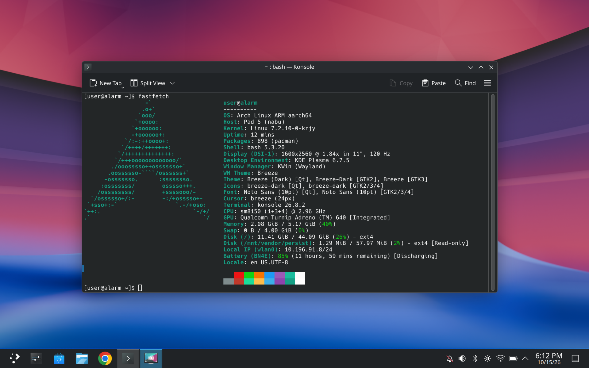

# Arch Linux ARM Installer for Xiaomi Pad 5 (nabu)


---

## Table of Contents

- [Requirements](#requirements)
- [Hardware Support Status](#hardware-support-status)
- [Installation](#installation)
  - [Method 1: Single Boot (Fastboot / Standalone Linux)](#method-1-single-boot-fastboot--standalone-linux)
  - [Method 2: Dual / Triple Boot (via TWRP Recovery)](#method-2-dual--triple-boot-via-twrp-recovery)
- [Updating the Kernel](#updating-the-kernel)
- [Troubleshooting](#troubleshooting)
- [Credit & Thanks](#credit--thanks)
- [See Also](#see-also)

---

## Requirements

- Xiaomi Pad 5 (nabu)
- Unlocked bootloader
- [TWRP](https://github.com/Kumar-Jy/twrp_device_xiaomi_nabu/releases/tag/mod-hybrid) custom recovery
- Installer zip from [Releases](https://github.com/Kumar-Jy/Nabu-arch-images/releases/tag/arch-nabu)

---

## Hardware Support Status

| Category | Hardware Feature | Status | Notes |
| :--- | :--- | :---: | :--- |
| **Display** | 2.5K WQHD+ LCD (2560x1600 @ 120Hz / 60Hz) | ✅ Working | Novatek NT36523 panel driver, smooth 120Hz refresh rate and seamless 60Hz mode switching |
| **Touch** | Capacitive Multi-touch | ✅ Working | 10-point multi-touch supported out of the box |
| **Graphics** | 3D GPU Acceleration (Adreno 640) | ✅ Working | Mesa Turnip (Vulkan 1.3) & Freedreno (OpenGL 4.6) |
| **Video Decode** | Hardware Video Acceleration | ✅ Working | Iris/Venus V4L2 decode (H.264, HEVC, VP9) via `iris-vaapi` with `mpv` and `vlc-nabu` |
| **Audio** | Quad Stereo Speakers & Headphone | ✅ Working | Cirrus Logic CS35L41 quad amplifiers, wired 3.5mm headphone playback DAI, ALSA UCM + PipeWire |
| **Microphone** | Built-in Mic Array | ✅ Working | Clear audio recording via PipeWire |
| **Camera (Rear)** | 13MP OmniVision OV13B10 | ✅ Working | `camera-studio` / libcamera with VCM autofocus |
| **Camera (Front)** | 8MP OmniVision OV8856 | ✅ Working | `camera-studio` with upright orientation correction |
| **Flash / Torch** | Dual Rear LED Flash | ✅ Working | Hardware flash control via `nabu-torch` (GUI/CLI with intensity control) or sysfs |
| **Wireless** | Wi-Fi 5 (802.11ac 2.4/5GHz) | ✅ Working | Qualcomm WCN3990 via NetworkManager with persistent MAC (`nabu-pmac`) |
| **Bluetooth** | Bluetooth 5.0 | ✅ Working | Qualcomm WCN3990 via BlueZ |
| **Sensors** | Accelerometer & Gyroscope | ✅ Working | SLPI/SSC via FastRPC & `iio-sensor-proxy` |
| **Screen Rotation** | Automatic Screen Rotation | ✅ Working | Handled via `nabu-tablet-mode` daemon |
| **Auto-Brightness** | Ambient Light Sensor (ALS) | ✅ Working | Native `gsd-power` on GNOME, `nabu-autobrightness` on Plasma |
| **Stylus (Input)** | Xiaomi Smart Pen (Drawing & Input) | ✅ Working | 4096 pressure levels, tilt, hover, and dual barrel buttons via `NVTCapacitivePen` |
| **Stylus (Charging)** | Wireless Magnetic Pen Charging | ✅ Working | Supported via IDT P9418 driver (integrated in 7.3 kernel) |
| **Accessories** | Magnetic Pogo-Pin Keyboard Cover | ✅ Working | Instant physical typing via serial pogo connector |
| **Battery & Power** | Battery Telemetry & Fast Charging | ✅ Working | PM8150B BMS charger driver, LN8000 33W direct fast charge, battery gauge, 15W-27W USB-PD and QC charging |
| **Sleep** | Suspend & Resume | ✅ Working | S2idle sleep with post-resume sensor recovery |
| **USB** | USB Type-C 2.0 & OTG | ✅ Working | Flash drives, mice, keyboards, hubs supported |
| **External Display** | USB DisplayLink Output | ✅ Working | Supported with DisplayLink docks (`displaylink` + `evdi`) |
| **External Display** | USB-C DisplayPort Alt-Mode | ❌ Not Supported | Hardware limitation (SoC USB lines lack DP routing) |
| **DRM** | Widevine L1 (HD Streaming) | ❌ Not Supported | Widevine L3 software works; L1 requires Android TEE |

---

## Installation

### Method 1: Single Boot (Fastboot / Standalone Linux)

This method flashes Arch Linux ARM as the sole operating system on your tablet directly from your PC via **Fastboot** (no TWRP or repartitioning needed).

1. **Download the installer**:
   - Get the installer ZIP from [Releases](https://github.com/Kumar-Jy/Nabu-arch-images/releases) (e.g. `nabu-plasma-installer.zip` or `nabu-gnome-installer.zip`), or download via the CLI scripts (`get-plasma.sh` / `get-gnome.sh`).
2. **Unzip the installer** on your computer.
3. **Reboot the tablet into Fastboot Mode**:
   - Power off your tablet, then hold **Power + Volume Down** until the FASTBOOT screen appears.
   - Connect the tablet to your computer via USB.
4. **Flash using the automated script**:
   - **Linux / macOS**:
     ```bash
     chmod +x flash-linux.sh
     ./flash-linux.sh
     ```
   - **Windows**: Double-click `flash-linux.bat`

#### 🛠️ Manual Fastboot Commands
If you prefer running the commands manually:
```bash
# 1. Flash Aloha UEFI to the boot partition (both slots)
fastboot flash boot_ab images/alohauefi.img

# 2. Flash ESP to the cust partition
fastboot flash cust images/esp.img

# 3. Flash rootfs to the userdata partition
fastboot flash userdata images/rootfs.img

# 4. Reboot into Arch Linux
fastboot reboot
```
> [!NOTE]
> `alohauefi.img` is included directly in the installer `images/` directory and is also available as a standalone download from [Releases](https://github.com/Kumar-Jy/Nabu-arch-images/releases).

---

### Method 2: Dual / Triple Boot (via TWRP Recovery)

For dual-booting with Android or triple-booting with Windows and Android.

#### Creating Partitions (if not already present)

If your device doesn't have the required `esp` and `linux` partitions, create them first:

1. **Boot into TWRP** from your PC:
   ```bash
   fastboot boot twrp.img
   ```

2. **Open TWRP Terminal**: In TWRP, go to **Advanced > Terminal**

3. **Run the partition tool**:
   ```bash
   partition
   ```
   Follow the on-screen instructions to create the `win` (optional), `linux` and `esp` partitions.

4. **Reboot back into TWRP** after partitioning: Go to **Reboot > Recovery**

5. Proceed to the installation steps below.

#### Triple Boot (Windows + Android + Linux)

1. **Install Windows first** — Set up Windows on the `win` partition
2. **Return to Android** — Boot back into Android to ensure it's working
3. **Flash the Linux installer** — Boot into TWRP and flash the Arch Linux installer zip
4. **Reboot** — rEFInd will show all three boot options (Windows, Android, Linux)

#### Flashing Installer in TWRP

1. **Boot into TWRP**: Power off the tablet, hold **Power + Volume Up**
2. **Flash the installer zip**: In TWRP, tap **Install**, navigate to the zip, swipe to confirm
3. **What the installer does**:
   - Formats `/dev/block/by-name/linux` with ext4
   - Extracts the rootfs image onto the partition
   - Patches the `boot` partition with DBKP + UEFI payload
   - Sets up ESP with rEFInd and the Unified Kernel Image
4. **Reboot**: Select **Reboot > System**
5. **Default credentials**: `user` / `123456`

---

## Updating the Kernel

### Official update (from the nabu repository)

```bash
sudo pacman -Syu linux-nabu linux-nabu-headers
```

### Local / custom (non-official) kernel update

If you built your own kernel package:

```bash
sudo pacman -U linux-nabu-<version>-aarch64.pkg.tar.xz
```

To repair boot configuration or force a rebuild manually:

```bash
sudo nabu-boot-repair
```
or directly:
```bash
sudo /usr/libexec/nabu/uki-regenerate
```

To clean up old backed-up kernel modules and backup UKIs after an update:

```bash
sudo nabu-kclean
# or preview first: sudo nabu-kclean --dry-run
# (alias: sudo kclean)
```

> Tablet will not boot after an update? See
> [Tablet does not boot after a kernel update](TROUBLESHOOTING.md#tablet-does-not-boot-after-a-kernel-update).

## Troubleshooting

For solutions to common issues (such as boot loops after updates, Wi-Fi MAC address fixes, or recovering from a locked emergency console), see the [Troubleshooting Guide](TROUBLESHOOTING.md).

---

## Credit & Thanks

| Component | Description | Author |
| :--- | :--- | :--- |
| Arch-Installer | Arch Installer script | [Kumar-Jy](https://github.com/Kumar-Jy) |
| RootFS & EFI | Arch RootFS and kernel | [Kumar-Jy](https://github.com/Kumar-Jy), [rodriguest](https://github.com/rodriguezst), [TwinbornPlate75](https://github.com/TwinbornPlate75), [Timofey](https://github.com/timoxa0) |
| DBKP | DualBoot kernel patcher and UEFI payload | [rodriguest](https://github.com/rodriguezst), [remtrik](https://github.com/remtrik), [map220v](https://github.com/map220v), [Project Aloha](https://github.com/Project-Aloha) |

## See Also

- [postmarketOS](https://wiki.postmarketos.org/wiki/Xiaomi_Pad_5_%28xiaomi-nabu%29) — pmOS for nabu
- [pocketblue](https://github.com/pocketblue/pocketblue) — Fedora Silverblue for nabu
- [nabu-fedora](https://github.com/jhuang6451/nabu_fedora) — Fedora for nabu
- [nabu-alarm](https://github.com/nabu-alarm/) — Arch Linux ARM for nabu (EOL)
- [Xiaomi-Nabu](https://github.com/TheMojoMan/Xiaomi-Nabu) — Ubuntu for nabu
