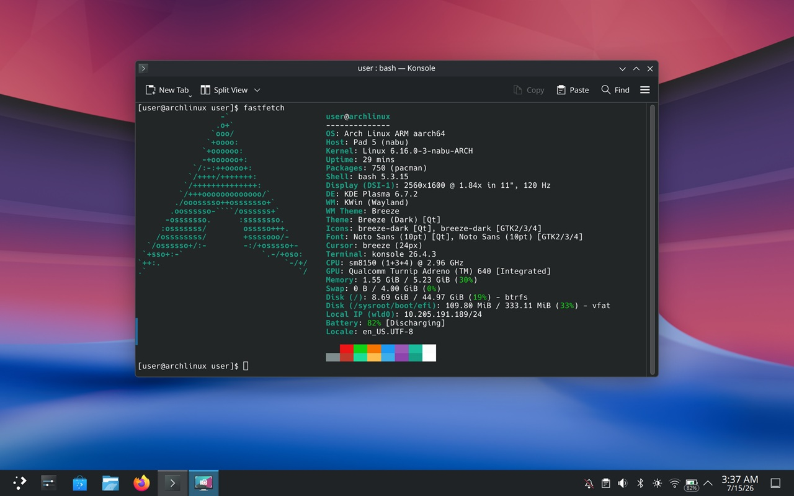

# Arch Linux ARM Installer for Xiaomi Pad 5 (nabu)



Arch Linux ARM with **bootc** (ostree-based) updates for the Xiaomi Pad 5 (Snapdragon 860). Supports dual/triple-boot with Android/Windows via DBKP and UEFI, as well as standalone single-boot via Aloha UEFI and Fastboot.

- [Requirements](#requirements)
- [Hardware Support Status](#hardware-support-status)
- [Installation](#installation)
  - [Method 1: Single Boot (Fastboot / Standalone Linux)](#method-1-single-boot-fastboot--standalone-linux)
  - [Method 2: Dual / Triple Boot (via TWRP Recovery)](#method-2-dual--triple-boot-via-twrp-recovery)
- [First Boot & Post-Install](#first-boot--post-install)
- [Managing the System](#managing-the-system)
- [Container Images](#container-images)
- [Troubleshooting](#troubleshooting)
- [Building from Source](#building-from-source)
- [Credit & Thanks](#credit--thanks)

---

## Requirements

- Xiaomi Pad 5 (nabu)
- Unlocked bootloader
- USB Type-C cable and a PC (Linux, macOS, or Windows)
- [TWRP](https://github.com/Kumar-Jy/twrp_device_xiaomi_nabu/releases/tag/mod-hybrid) custom recovery (only needed for Method 2 Dual/Triple boot)
- Installer zip from [Releases](https://github.com/Kumar-Jy/Nabu-arch-images/releases/tag/arch-atomic)

---

## Hardware Support Status

| Category | Hardware Feature | Status | Notes |
| :--- | :--- | :---: | :--- |
| **Display** | 2.5K WQHD+ LCD (2560x1600 @ 120Hz / 60Hz) | ✅ Working | Novatek NT36523 panel driver, smooth 120Hz refresh rate and seamless 60Hz mode switching |
| **Touch** | Capacitive Multi-touch | ✅ Working | 10-point multi-touch supported out of the box |
| **Graphics** | 3D GPU Acceleration (Adreno 640) | ✅ Working | Mesa Turnip (Vulkan 1.3) & Freedreno (OpenGL 4.6) |
| **Video Decode** | Hardware Video Acceleration | ✅ Working | Iris/Venus V4L2 decode (H.264, HEVC, VP9) via `iris-vaapi` with `mpv` and browsers |
| **Audio** | Quad Stereo Speakers & Headphone | ✅ Working | Cirrus Logic CS35L41 quad amplifiers, wired 3.5mm headphone playback DAI, ALSA UCM + PipeWire |
| **Microphone** | Built-in Mic Array | ✅ Working | Clear audio recording via PipeWire |
| **Camera (Rear)** | 13MP OmniVision OV13B10 | ✅ Working | `camera-studio` / libcamera with VCM autofocus |
| **Camera (Front)** | 8MP OmniVision OV8856 | ✅ Working | `camera-studio` with upright orientation correction |
| **Flash / Torch** | Dual Rear LED Flash | ✅ Working | Hardware flash control via `nabu-torch` (GUI/CLI with intensity control) or sysfs |
| **Wireless** | Wi-Fi 5 (802.11ac 2.4/5GHz) | ✅ Working | Qualcomm WCN3990 via NetworkManager with persistent MAC (`nabu-pmac`) |
| **Bluetooth** | Bluetooth 5.0 | ✅ Working | Qualcomm WCN3990 via BlueZ |
| **Sensors** | Accelerometer & Gyroscope | ✅ Working | SLPI/SSC via FastRPC, `hexagonrpcd` & `iio-sensor-proxy` |
| **Screen Rotation** | Automatic Screen Rotation | ✅ Working | Handled via `nabu-tablet-mode` daemon |
| **Auto-Brightness** | Ambient Light Sensor (ALS) | ✅ Working | Native `gsd-power` on GNOME, `nabu-autobrightness` on Plasma |
| **Stylus (Input)** | Xiaomi Smart Pen (Drawing & Input) | ✅ Working | 4096 pressure levels, tilt, hover, and dual barrel buttons via `NVTCapacitivePen` |
| **Stylus (Charging)** | Wireless Magnetic Pen Charging | ✅ Working | Supported via IDT P9418 driver (integrated in 7.3 kernel) |
| **Accessories** | Magnetic Pogo-Pin Keyboard Cover | ✅ Working | Instant physical typing via serial pogo connector |
| **Battery & Power** | Battery Telemetry & Fast Charging | ✅ Working | PM8150B BMS charger driver, LN8000 33W direct fast charge, battery gauge, 15W-27W USB-PD and QC charging |
| **Sleep** | Suspend & Resume | ✅ Working | S2idle sleep with post-resume sensor recovery |
| **USB** | USB Type-C 2.0 & OTG | ✅ Working | Flash drives, mice, keyboards, hubs supported |
| **External Display** | USB DisplayLink Output | ✅ Working | Supported with DisplayLink docks (`displaylink` + `evdi`) |
| **External Display** | USB-C DisplayPort Alt-Mode | ❌ Not Supported | Hardware limitation (SoC USB lines lack DP routing) |
| **DRM** | Widevine L1 (HD Streaming) | ❌ Not Supported | Widevine L3 software works; L1 requires Android TEE |

---

## Installation

### Method 1: Single Boot (Fastboot / Standalone Linux)

This method flashes Arch Linux ARM as the sole operating system on your tablet directly from your PC via **Fastboot** (no TWRP or repartitioning needed).

1. **Download the installer**:
   - Get the installer ZIP from [Releases](https://github.com/Kumar-Jy/Nabu-arch-images/releases/tag/arch-atomic) (`Nabu-alarm-atomic-plasma-installer.zip` or `Nabu-alarm-atomic-gnome-installer.zip`), or download via the CLI scripts (`get-plasma.sh` / `get-gnome.sh`).
2. **Unzip the installer** on your computer.
3. **Reboot the tablet into Fastboot Mode**:
   - Power off your tablet, then hold **Power + Volume Down** until the FASTBOOT screen appears.
   - Connect the tablet to your computer via USB.
4. **Flash using the automated script**:
   - **Linux / macOS**:
     ```bash
     chmod +x flash-linux.sh
     ./flash-linux.sh
     ```
   - **Windows**: Double-click `flash-linux.bat`

#### 🛠️ Manual Fastboot Commands
If you prefer running the commands manually:
```bash
# 1. Flash Aloha UEFI to the boot partition (both slots)
fastboot flash boot_ab images/alohauefi.img

# 2. Flash ESP to the cust partition
fastboot flash cust images/esp.img

# 3. Flash rootfs to the userdata partition
fastboot flash userdata images/rootfs.img

# 4. Reboot into Arch Linux
fastboot reboot
```
> [!NOTE]
> `alohauefi.img` is included directly in the installer `images/` directory.

---

### Method 2: Dual / Triple Boot (via TWRP Recovery)

### Partition layout

The installer expects these GPT partitions. They're usually already present from a Windows/dual-boot setup:

| Partition | Block device | Format | Purpose |
|-----------|-------------|--------|---------|
| `boot` | `/dev/block/bootdevice/by-name/boot` | Android boot | Patched with DBKP + UEFI payload |
| `esp` | `/dev/block/by-name/esp` | FAT32 | EFI System Partition (rEFInd, UKI, Windows) |
| `win` | `/dev/block/by-name/win` | NTFS | Windows (optional) |
| `linux` | `/dev/block/by-name/linux` | Btrfs | Arch Linux root |

### Step 1: Create partitions (if needed)

If your device doesn't have `esp` and `linux` partitions yet:

1. Boot TWRP from your PC: `fastboot boot twrp.img`
2. Open **Advanced > Terminal** in TWRP
3. Run `partition` and follow the on-screen prompts
4. Reboot back into TWRP (**Reboot > Recovery**)

### Step 2: Flash the installer

1. Download the installer zip for your desktop:
   - `Nabu-alarm-atomic-plasma-installer.zip` — Plasma Desktop
   - `Nabu-alarm-atomic-gnome-installer.zip` — GNOME Desktop
2. Boot TWRP (hold **Power + Volume Up**)
3. Tap **Install**, select the zip, swipe to confirm

The installer formats the `linux` partition with Btrfs, extracts the rootfs, patches the boot partition with UEFI payload, and sets up rEFInd on ESP.

### Step 3: First boot

1. Reboot (**Reboot > System**)
2. On first boot, `grow-rootfs.service` attempts to expand the filesystem to fill the partition. Verify it worked:
   ```bash
   journalctl -u grow-rootfs.service
   sudo btrfs filesystem usage /
   ```
3. If it didn't expand automatically:
   ```bash
   sudo btrfs filesystem resize max /
   sudo btrfs filesystem usage /
   ```
4. Default login: `user` / `123456`

### Boot menu

rEFInd shows at boot and lets you choose between Android, Arch Linux, and Windows. On first UEFI boot, Windows BCD is reconfigured automatically. If Secure Boot is detected, ESP is reformatted to handle it.

---

## First Boot & Post-Install

### Change the default password

```bash
passwd user
```

### Check bootc is working

```bash
bootc status
```

### Timezone

The system defaults to UTC. To change it:

```bash
timedatectl list-timezones      # list available zones
sudo timedatectl set-timezone Asia/Kolkata
```

### Install packages

Packages installed via `pacman -S` on the live system are **lost on the next `bootc upgrade`**. Use these methods instead:

**Flatpak** (GUI apps, survives upgrades)
```bash
flatpak install flathub org.mozilla.firefox
```

**Distrobox** (CLI/dev tools, survives upgrades)
```bash
distrobox create --name arch --image docker.io/menci/archlinuxarm:latest
distrobox enter arch
```

**Custom container image** (permanent, survives upgrades)
```bash
# Containerfile
FROM ghcr.io/kumar-jy/nabu-plasma:latest
RUN pacman -Syu --noconfirm neovim htop

podman build -t my-image .
sudo bootc switch my-image
```

**Temporary pacman** (lost on upgrade) — only for testing:
```bash
sudo bootc usr-overlay
sudo pacman -S neovim
```

### AUR packages

```bash
sudo pacman -S --needed base-devel git
git clone https://aur.archlinux.org/yay.git && cd yay && makepkg -si
yay -S some-aur-package
```

---

## Managing the System

### bootc (OS updates)

```bash
bootc status                          # current deployment info
sudo bootc upgrade                    # fetch update (staged for next boot)
sudo bootc upgrade --apply            # fetch + stage immediately
sudo bootc reboot                     # boot into new deployment
sudo bootc rollback                   # revert to previous deployment
```

> `bootc-fetch-apply-updates.service` automatically checks for updates on a timer.

### Kernel updates

The kernel (`linux-nabu`) is part of the container image. Just update and reboot:

```bash
sudo bootc upgrade --apply
sudo reboot
```

`nabu-uki-sync.service` regenerates the UKI on boot automatically.

### Managing deployments

```bash
bootc status                          # list all deployments
sudo ostree admin pin 0               # pin current to prevent GC
sudo ostree admin cleanup --keep=3    # remove old deployments
```

### System maintenance

```bash
sudo pacman -Scc                     # clean package cache
sudo btrfs scrub start /             # check Btrfs health
sudo btrfs filesystem df /           # disk usage
sudo btrfs balance start -dusage=50 /  # rebalance space
```

> ⚠️ Never run `btrfs check` on a mounted filesystem. Boot to TWRP and run it on the unmounted partition: `btrfs check /dev/block/by-name/linux`

---

## Container Images

Pre-built images on GHCR:

| Image | Description |
|-------|-------------|
| `ghcr.io/kumar-jy/nabu-base:latest` | Base system |
| `ghcr.io/kumar-jy/nabu-plasma:latest` | + Plasma Desktop |
| `ghcr.io/kumar-jy/nabu-gnome:latest` | + GNOME Desktop |

```bash
sudo bootc switch ghcr.io/kumar-jy/nabu-plasma:latest
sudo reboot
```

---

## Troubleshooting

### Boot loops or no boot

- Reboot to TWRP and re-flash the installer zip
- Verify the `linux` partition exists and is formatted

### WiFi not working

```bash
sudo systemctl enable --now NetworkManager
nmcli device wifi list
nmcli device wifi connect <SSID> password <password>
```

### Sound not working

```bash
arecord -l
aplay -l
sudo alsaucm list
```

### Distrobox / Podman fails (newuidmap/newgidmap errors)

```bash
sudo ostree admin unlock --hotfix
sudo chmod u+s /usr/bin/newuidmap /usr/bin/newgidmap
```

Also, avoid `archlinux:latest` from Docker Hub — it has no arm64 builds. Use `docker.io/menci/archlinuxarm:latest` instead.

### Filesystem not growing on first boot

```bash
journalctl -u grow-rootfs.service
sudo btrfs filesystem resize max /
sudo btrfs filesystem usage /
```

### bootc update fails

```bash
bootc status
sudo bootc upgrade
sudo reboot
```

---

## Building from Source

### Prerequisites

- Docker or Podman
- ARM64 runner (or QEMU user-static for cross-compilation)

### Build images

```bash
# Base
podman build -t nabu-base -f base/Containerfile base/

# Desktop
podman build -t nabu-plasma --build-arg BASE_IMAGE=nabu-base:latest -f plasma/Containerfile plasma/
podman build -t nabu-gnome --build-arg BASE_IMAGE=nabu-base:latest -f gnome/Containerfile gnome/
```

---

## Credit & Thanks

| Component | Description | Author |
| :--- | :--- | :--- |
| Arch-Installer | Arch Installer script | [Kumar-Jy](https://github.com/Kumar-Jy) |
| RootFS & EFI | Arch RootFS and kernel | [Kumar-Jy](https://github.com/Kumar-Jy), [rodriguest](https://github.com/rodriguezst), [Timofey](https://github.com/timoxa0) |
| DBKP/ | DualBoot kernel patcher and UEFI payload | [rodriguest](https://github.com/rodriguezst), [remtrik](https://github.com/remtrik), [map220v](https://github.com/map220v), [Project Aloha](https://github.com/Project-Aloha) |

## See Also

- [postmarketOS](https://wiki.postmarketos.org/wiki/Xiaomi_Pad_5_%28xiaomi-nabu%29) — pmOS for nabu
- [pocketblue](https://github.com/pocketblue/pocketblue) — Fedora Silverblue for nabu
- [nabu-fedora](https://github.com/jhuang6451/nabu_fedora) — Fedora for nabu
- [nabu-alarm](https://github.com/nabu-alarm/) — Arch Linux ARM for nabu (EOL)
- [Xiaomi-Nabu](https://github.com/TheMojoMan/Xiaomi-Nabu) — Ubuntu for nabu
